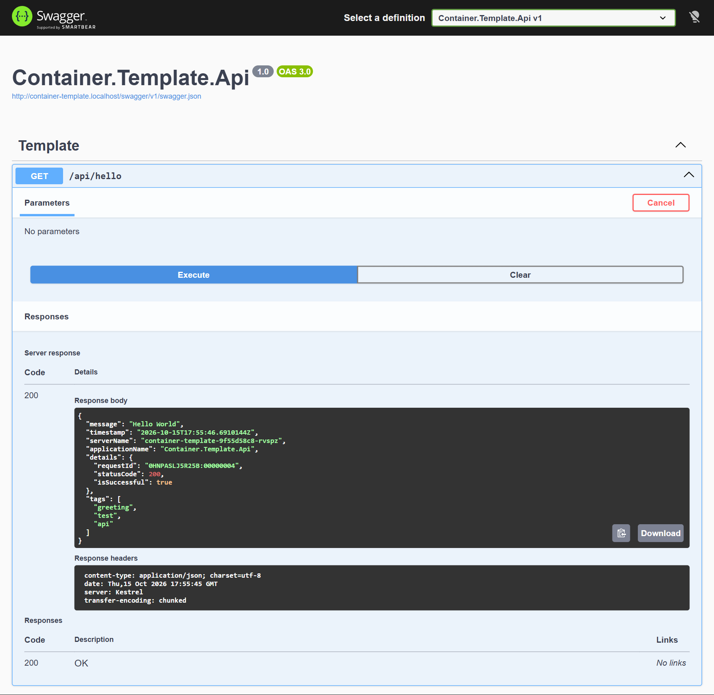
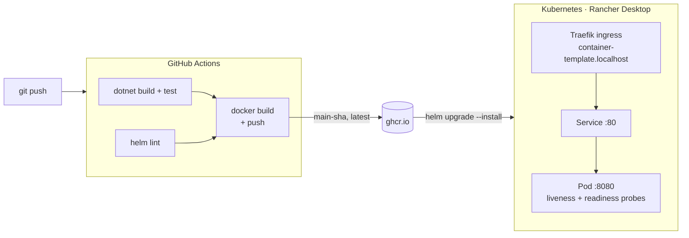

<div align="center">


# container-template

**A production-shaped starting point for containerized .NET services.** It's an ASP.NET Core Web API with health probes, structured logging, tests, a CI pipeline that publishes to GitHub Container Registry, and a Helm chart that deploys it to Kubernetes with one command.

[](https://github.com/alan-connor/container-template/actions/workflows/ci.yml)
[](LICENSE)
<br />


</div>

---

## Why this template?

Spinning up a new service usually means repeating the same plumbing before writing any business logic: a Dockerfile, health checks, logging, a pipeline and deployment manifests. This repo is that plumbing, already wired together and verified end to end. Clone it, rename one project, and start on the part that matters.

| | |
|---|---|
| 🐳 **Lean, non-root image** | Multi-stage Dockerfile: restore is cached separately from the source, the final image is the ASP.NET runtime only, and it runs as the built-in non-root `app` user on port 8080. |
| 💓 **Kubernetes-ready health probes** | Separate `/healthz/live` and `/healthz/ready` endpoints, wired into the Helm chart's liveness and readiness probes. Add dependency checks with the `ready` tag. |
| 📜 **Structured logging** | Serilog writes readable text in Development and one JSON object per line everywhere else, ready for any log shipper. Health-probe noise is filtered out. |
| ✅ **Tested** | Integration tests host the real app in memory with `WebApplicationFactory` and cover the API, every health endpoint and per-environment Swagger behavior. |
| 🚀 **CI → GHCR** | GitHub Actions builds and tests the solution, lints the Helm chart, then builds the image and pushes it to `ghcr.io` with branch, SHA, semver and `latest` tags. |
| ☸️ **One-command deploy** | A Helm chart plus `deploy-local.ps1` deploys to a local Rancher Desktop (k3s) cluster behind Traefik at `http://container-template.localhost`. |

<div align="center">
  
  <br />
  <sub>Swagger UI served from the local cluster. <code>serverName</code> is the Kubernetes pod that handled the request.</sub>
</div>

## How it fits together



## Quick start

### Run it locally

```bash
dotnet run --project src/Container.Template.Api
```

Then open <http://localhost:5000/swagger>. Swagger is enabled in Development only.

### Run the tests

```bash
dotnet test container-template.slnx
```

### Run it in Docker

```bash
docker build -t container-template .
docker run --rm -p 8080:8080 container-template
curl http://localhost:8080/api/hello
```

### Deploy it to Kubernetes (Rancher Desktop)

Prerequisites: [Rancher Desktop](https://rancherdesktop.io/) running with its bundled Traefik ingress (the default), `kubectl` pointed at the `rancher-desktop` context, and `helm`.

```powershell
.\deploy-local.ps1                                   # deploy :latest from ghcr.io
.\deploy-local.ps1 -Tag main-abc1234                 # deploy an exact build
.\deploy-local.ps1 -Tag main-abc1234 -GhcrPat $env:GHCR_PAT   # private package
.\deploy-local.ps1 -Uninstall                        # remove the release and namespace
```

Then browse to <http://container-template.localhost/api/hello> or <http://container-template.localhost/swagger>. `*.localhost` resolves to `127.0.0.1`, so no hosts-file edit is needed.

The script refuses to run against any context other than `rancher-desktop` unless you pass `-Force`.

<details>
<summary><b>deploy-local.ps1 parameters</b></summary>

| Parameter | Default | Description |
|---|---|---|
| `-Tag` | `latest` | Image tag to deploy. Prefer immutable `main-<sha>` tags for repeatable deploys. |
| `-GhcrPat` | *(empty)* | GitHub token with `read:packages`. Only needed for a private package; creates the `ghcr-pull` secret and wires it in. |
| `-Namespace` | `container-template` | Target namespace. |
| `-Uninstall` | *(switch)* | Remove the release and namespace instead of deploying. |
| `-Force` | *(switch)* | Allow deploying to a kubectl context other than `rancher-desktop`. |

</details>

<details>
<summary><b>Deploy a locally built image (no registry)</b></summary>

Rancher Desktop's Kubernetes shares images with its Docker engine, so you can skip the registry entirely:

```powershell
docker build -t container-template:local .
helm upgrade --install container-template .\helm -n container-template --create-namespace `
  --set image.repository=container-template --set image.tag=local --set image.pullPolicy=Never
```

</details>

<details>
<summary><b>Manual Helm usage and useful commands</b></summary>

```powershell
# (private package only) create the pull secret first
kubectl create namespace container-template
kubectl create secret docker-registry ghcr-pull -n container-template `
  --docker-server=ghcr.io --docker-username=<github-user> --docker-password=$env:GHCR_PAT

helm upgrade --install container-template .\helm -n container-template --create-namespace `
  --set image.tag=latest
  # private package: --set imagePullSecrets[0].name=ghcr-pull

kubectl get pods -n container-template -w
kubectl logs -n container-template deploy/container-template -f
kubectl rollout restart deploy/container-template -n container-template   # re-pull :latest
kubectl port-forward -n container-template svc/container-template 8080:80  # if ingress is off
```

</details>

## Endpoints

| Method | Path | Description |
|---|---|---|
| `GET` | `/api/hello` | Sample JSON response (message, timestamp, server name, request id) |
| `GET` | `/healthz` | Basic "process is up" check; runs no health checks |
| `GET` | `/healthz/live` | Liveness probe: checks tagged `live` |
| `GET` | `/healthz/ready` | Readiness probe: checks tagged `ready` |
| `GET` | `/swagger` | Swagger UI, when `Swagger:Enable` is `true` |

The container listens on **port 8080**.

## Configuration

| Setting | Where | Default |
|---|---|---|
| `Swagger:Enable` | `appsettings*.json` or the `Swagger__Enable` env var | `false`; `true` in Development |
| `ASPNETCORE_ENVIRONMENT` | `helm/values.yaml` → `env` | `Production` |
| `image.repository` / `image.tag` | `helm/values.yaml` | `ghcr.io/alan-connor/container-template:latest` |
| `imagePullSecrets` | `helm/values.yaml` | empty (public package) |
| `ingress.enabled` / `ingress.host` | `helm/values.yaml` | `true` / `container-template.localhost` |
| `resources` | `helm/values.yaml` | none set |

The local chart sets `Swagger__Enable: "true"` so the UI is reachable in the cluster. Remove it for any shared environment.

## Container images

The CI workflow publishes to `ghcr.io/alan-connor/container-template` on every push to `main` or `develop`:

| Tag | When |
|---|---|
| `latest` | Every push to `main` |
| `main-<sha>` / `develop-<sha>` | Every push; immutable, so prefer these for deploys |
| `main` / `develop` | Moves with the branch |
| `1.2.3`, `1.2` | When a `v1.2.3` tag is pushed |

Pull requests build the image to prove it still builds, but don't push it.

## Use it for your own service

1. Click **Use this template** on GitHub (or clone the repo).
2. Rename `Container.Template.Api` and `container-template` to your service name. That covers the project folders and namespaces, `container-template.slnx`, the Dockerfile paths, `helm/Chart.yaml` and `helm/values.yaml`, and `deploy-local.ps1`.
3. Replace `TemplateController` with your endpoints, and add dependency checks with the `ready` tag in `Program.cs`.
4. Push to `main`. CI publishes your image to `ghcr.io/<you>/<repo>`.

## Project structure

```
container-template/
├── src/Container.Template.Api/      # ASP.NET Core Web API
│   ├── Controllers/                 # TemplateController (GET /api/hello)
│   ├── Extensions/                  # Serilog setup
│   └── Program.cs                   # host, health checks, Swagger
├── tests/Container.Template.Api.Tests/   # xUnit integration tests (WebApplicationFactory)
├── helm/                            # Chart: Deployment, Service, Traefik Ingress
├── .github/workflows/ci.yml         # test → helm lint → build and push image
├── Dockerfile                       # multi-stage, non-root, port 8080
└── deploy-local.ps1                 # one-command deploy to Rancher Desktop
```

## License

Licensed under the [MIT License](LICENSE).
